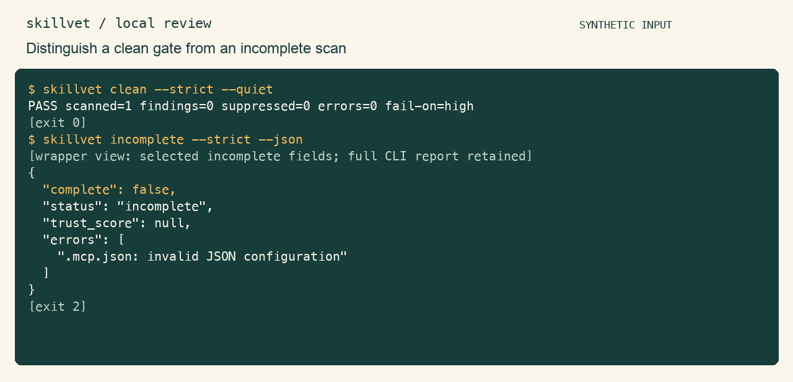

<p align="center"><strong>English</strong> &nbsp;·&nbsp; <a href="README.zh-CN.md">简体中文</a></p>

<p align="center"></p>
<h1 align="center">skillvet</h1>
<p align="center"><strong>Inspect a skill before you enable it.</strong></p>
<p align="center">Read agent skills, hooks, and MCP configuration locally. Inspect finite risk signals alongside the rules, exclusions, and references the scan could not follow.</p>
<p align="center"><a href="#quick-start">Quick start</a> &nbsp;·&nbsp; <a href="#usage">Usage</a> &nbsp;·&nbsp; <a href="docs/guide.md">Guide</a> &nbsp;·&nbsp; <a href="CONTRIBUTING.md">Contribute</a></p>

<p align="center"><a href="assets/demo.gif" title="Open the full-size usage demonstration"></a></p>

Real findings from synthetic skill, hook, and MCP fixtures. [Recording and reproduction](assets/README.md).

## Why skillvet?

An instruction file is only part of a downloaded skill. Configuration may grant tools, name scripts, or suppress findings. skillvet brings those supported static inputs into one review, while keeping dynamic references and skipped inputs visible.

## Quick start

Python 3.9+ on macOS or Linux. Scans use no third-party runtime dependencies. Installation may download build tools; scanned scripts are never executed.

Clone the published source, then install it in an isolated environment:

```bash
git clone --branch noah/skillvet https://github.com/LucasXlab/skillvet.git
cd skillvet
python3 -m venv .venv
. .venv/bin/activate
python -m pip install .
skillvet examples/clean-skill --json
```

The example should exit `0` with `complete: true`, `files_scanned: 1`, and no findings. Now replace `/absolute/path/to/downloaded-skill` with a directory you want to review:

```bash
skillvet /absolute/path/to/downloaded-skill --strict --fail-on high
```

Open each reported `path:line` and review its remediation before enabling the skill. Exit `1` means the selected severity gate found something to review. Exit `2`, including **zero supported files scanned**, means the scan cannot be treated as a clean result. Recognized inputs include `SKILL.md`, `AGENTS.md`, `CLAUDE.md`, supported hook/MCP JSON, and scripts in supported directories. An arbitrary Markdown filename is not automatically an instruction file.

## Usage

### Inspect an unfamiliar directory

```bash
skillvet ./downloaded-skill --strict --json
skillvet ./downloaded-skill --strict --sarif
skillvet --list-rules
```

`--strict` ignores the target's `.skillvetignore` and inline suppressions. Your explicit `--ignore` choices still apply.

Read `complete`, `errors`, `coverage_notes`, `skipped`, and `suppressed` together. A completed selected-file read does not imply that dynamic references were followed. Exit `1` means a finding met the gate; exit `2` means invalid or incomplete processing.

## Scope

A clean scan is not a safety verdict. Rules, frontmatter parsing, script discovery, and redaction are finite. The legacy score is not a safety probability. Review reports before sharing; full limits and recorded feature examples are in the guide.

See the [usage guide](docs/guide.md) for more examples, exact parameters, and technical boundaries.

## Contributing

Start with [CONTRIBUTING.md](CONTRIBUTING.md). Use synthetic reproductions and report the validation you actually ran.

[MIT License](LICENSE) · [简体中文](README.zh-CN.md)
