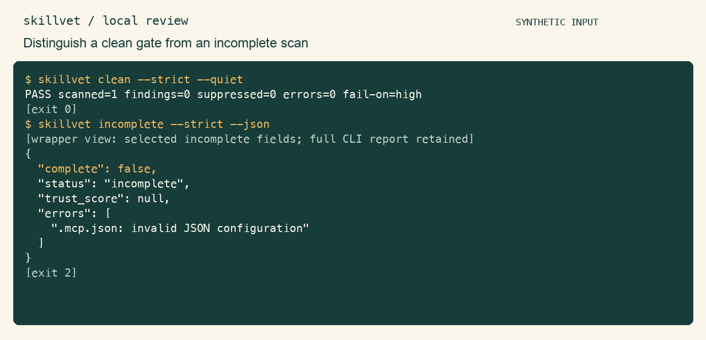

<p align="center"><a href="README.md">English</a> &nbsp;·&nbsp; <strong>简体中文</strong></p>

<p align="center"></p>
<h1 align="center">skillvet</h1>
<p align="center"><strong>启用之前，先查技能里的风险信号。</strong></p>
<p align="center">在本地检查技能、hook 与 MCP 配置，同时查看风险信号、规则依据、排除项和未能跟随的引用。</p>
<p align="center"><a href="#快速开始">快速开始</a> &nbsp;·&nbsp; <a href="#实际使用">使用方式</a> &nbsp;·&nbsp; <a href="docs/guide.zh-CN.md">完整手册</a> &nbsp;·&nbsp; <a href="CONTRIBUTING.md">参与贡献</a></p>

<p align="center"><a href="assets/demo.gif" title="点击查看原尺寸演示"></a></p>

合成技能、hook 与 MCP 配置上的真实检查结果。 [录制与复现](assets/README.md)。

## 为什么需要它

下载来的技能不只有一份指令。配置可能授予工具、引用脚本，甚至自带抑制规则。skillvet 把支持的静态输入放在一起检查，也把动态引用和跳过项留下来供人判断。

## 快速开始

需要 macOS / Linux 与 Python 3.9+。扫描无第三方运行依赖；安装可能下载构建工具，被扫描脚本不会执行。

克隆已发布源码，在独立环境中安装：

```bash
git clone --branch noah/skillvet https://github.com/LucasXlab/skillvet.git
cd skillvet
python3 -m venv .venv
. .venv/bin/activate
python -m pip install .
skillvet examples/clean-skill --json
```

示例应退出 `0`，并显示 `complete: true`、`files_scanned: 1`、无发现。接着把下面的 `/absolute/path/to/downloaded-skill` 换成你要审阅的技能目录：

```bash
skillvet /absolute/path/to/downloaded-skill --strict --fail-on high
```

按报告中的 `path:line` 打开源文件，结合修复建议决定是否启用。退出 `1` 表示发现达到所选严重度门槛的线索；退出 `2` 表示不能当作扫描通过，**没有扫到任何受支持文件也属于此情况**。支持的输入包括 `SKILL.md`、`AGENTS.md`、`CLAUDE.md`、指定 hook/MCP JSON，以及指定目录中的脚本；任意名称的 Markdown 文件不会自动作为指令文件扫描。CLI 发现说明目前使用英文，字段含义见[中文手册](docs/guide.zh-CN.md)。

## 实际使用

### 检查陌生目录

```bash
skillvet ./downloaded-skill --strict --json
skillvet ./downloaded-skill --strict --sarif
skillvet --list-rules
```

`--strict` 忽略目标自身的 `.skillvetignore` 与行内抑制；调用者显式传入的 `--ignore` 仍然生效。

一起看 `complete`、`errors`、`coverage_notes`、`skipped`、`suppressed`。选中文件处理完成，不代表动态引用也已跟随。退出 `1` 表示发现达到门槛，退出 `2` 表示参数错误或处理不完整。

## 适用边界

无发现不是安全结论。规则、frontmatter 解析、脚本发现与脱敏均有明确范围；旧分数不是安全概率。分享前需检查报告，完整限制和功能录制见手册。

详细参数、更多演示和技术边界见[中文使用手册](docs/guide.zh-CN.md)。

## 参与贡献

请从[贡献指南](CONTRIBUTING.md)开始，使用合成输入复现问题，并报告实际执行的验证。

[MIT 许可证](LICENSE) · [English](README.md)
