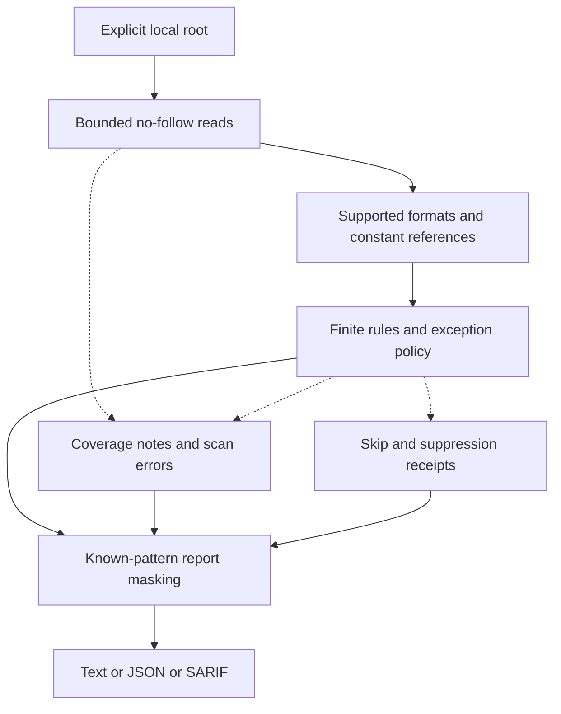

**English** · [简体中文](guide.zh-CN.md)

<p align="center"></p>
<h1 align="center">skillvet</h1>
<p align="center"><strong>Review what an agent skill can ask for.</strong></p>
<p align="center">
  <a href="../.github/workflows/ci.yml"></a>
  <a href="../LICENSE"></a>
  <a href="../pyproject.toml"></a>
  <a href="../pyproject.toml"></a>
  <a href="https://github.com/LucasXlab/skillvet"></a>
</p>

Inspect local skills, hooks, and MCP configuration for finite, explainable risk signals before enabling them. See the finding, its rule, and the parts the scan could not inspect. Scanned scripts are read as text, never executed.

[简体中文](../README.zh-CN.md) · [Quick start](#quick-start) · [Third-party review](#inspect-a-third-party-directory) · [Scope](#what-is-inspected) · [Exit codes](#boundaries-and-results) · [MIT](../LICENSE)


Real CLI capture on synthetic fixtures. Four JSON/SARIF views explicitly select report fields; the GIF extends reading holds. [Original cast](../assets/demo.cast) · [Full CLI reports](../assets/reports/) · [Recorded text](../assets/terminal.txt) · [Reproduce](../assets/README.md). These examples are finite rule signals, not safety verdicts.


## Before enabling a downloaded skill

An instruction file is only part of the package. A hook may name a script; a configuration may grant a tool permission; the directory may also contain its own suppression rules. skillvet reads the supported static assets together and reports both findings and coverage notes.

For unfamiliar input, start with `--strict`: it ignores the target's own `.skillvetignore` and inline suppressions. Your explicit `--ignore` choices still apply. A clean result is **not a safety verdict**; dynamic behavior and unrecognized patterns remain outside the model.

| Review task | Manual starting point | What skillvet provides |
|---|---|---|
| Inspect a known pattern | Search and read the matching text | A finite rule ID, severity and source location |
| Check an exception | Read the ignore file and inline directives | Explicit skipped/suppressed receipts and a strict-mode comparison |
| Track uninspected input | Follow configuration references by hand | Notes for supported references that could not be followed, plus processing errors |
| Feed local review tools | Transcribe findings | JSON and SARIF with processing state |

This compares workflows, not scanner accuracy. The [rule registry](../skillvet/rules.py), [discovery](../skillvet/discovery.py), and [report model](../skillvet/model.py) define the actual scope. There is no real-Skills precision/recall or competitor-advantage result yet.

## Quick start

From this source checkout, on Linux or macOS with Python 3.9+:

```sh
python3 -m venv .venv
.venv/bin/python -m pip install .
.venv/bin/skillvet examples/clean-skill --json
```

Installation can download the build backend. Scanning itself is offline and has no
third-party runtime dependencies. These instructions install this checkout; they do
not claim that a package has been published to a registry. Secure reading requires
POSIX descriptor-relative file access; other platforms return a scan error.

<details>
<summary>See actual CLI output</summary>


Rendered from a real stdout excerpt, not invented output. A JSON excerpt may be incomplete. [Text excerpt](../assets/readme-demo.txt) · [Reproduce](../docs/readme-demo.md).

</details>

## Inspect a third-party directory

```sh
.venv/bin/skillvet ./downloaded-skill --strict --json
.venv/bin/skillvet ./downloaded-skill --strict --sarif
.venv/bin/skillvet --list-rules
```

`--strict` ignores the target's `.skillvetignore` and inline suppressions. An explicit
caller-provided `--ignore GLOB` still applies. In compatibility mode, target-controlled
exceptions are honored and recorded in `skipped` / `suppressed` receipts. Review those
receipts rather than interpreting a lack of visible findings as complete coverage.

### Review the target's exceptions

This synthetic directory skips `CLAUDE.md` and suppresses two findings. Its selected-field JSON view preserves the source and reason of each exception; the score is null.


### Repeat the review in strict mode

The same directory now exposes the supported findings and exits 1. Explicit caller ignores remain in force; strict mode does not prove complete coverage.


## Read findings and coverage together

| Report field | Review question |
|---|---|
| Finding rule and severity | Which inspectable pattern triggered the signal? |
| `complete` and `errors` | Did selected-file processing finish without an error? |
| `coverage_notes` | Which script references could not be followed statically? |
| `skipped` / `suppressed` | Which input or finding was deliberately left out? |

`complete: true` does not erase exclusions or unfollowed references. The legacy score is a rule-signal summary, not a probability of safety. Use `--sarif` for a structured static-analysis report or `--json` for your own local review tooling.

### Keep processing state in SARIF

The selected-field view below retains the actual driver, invocation, rule and location. See the [full SARIF report](../assets/reports/sarif.sarif) for the unfiltered output; `executionSuccessful` describes scan processing, not the safety of the input.


## What is inspected

- Named instruction files, including `SKILL.md`, `AGENTS.md`, and `CLAUDE.md`.
- Named hook, MCP and plugin JSON configurations, including nested `.claude` settings.
- Scripts in recognized agent directories and statically named script references in
  configuration commands. Relative references try the project root first, then the
  configuration's directory; an ignored target remains unread.
- Exact permission-grant fields: `allowed-tools`, `allowed_tools`,
  `permissions.allow`, and `permissions.tools`. Deny lists and descriptions are not
  treated as grants. Rules and their actual scope appear in `--list-rules`.

### Inspect supported permission grants

SKILL frontmatter supports a deliberately small subset: top-level scalar strings,
inline string lists, and indented string-list items. Double quotes use JSON escapes;
single quotes support doubled quotes. Anchors, aliases, multiline scalars, nested
mappings, implicit numeric/boolean/null values, duplicate fields, and malformed metadata produce an explicit incomplete
scan. This is not a general YAML implementation or a validator for every agent format.

This fixture grants `Bash(*)` and `*` through the supported frontmatter field. It produces medium findings; the demo deliberately sets `--fail-on medium`.


Dynamic shell expressions are never expanded. External, missing, or dynamic script
references are not followed and are recorded in `coverage_notes`. Script contents are
not recursively interpreted to discover arbitrary downstream execution. Coverage is
limited to these declared static inputs, not the full behavior of the agent or shell.

## Boundaries and results

All selected reads use a root directory descriptor, refuse symbolic links and special
files, and check ignore rules before reading. The root itself must not be a symlink.
The defaults are 1 MiB per file, 16 MiB read in total, 10,000 selected files, and 50,000
visited directory entries. Byte/file limits are adjustable with `--max-file-bytes`,
`--max-total-bytes`, and `--max-files`; exceeding one makes the scan incomplete.
Dependencies, build caches, and `.git` are excluded by design. A changing filesystem
is not a consistent snapshot; run on a quiescent copy for repeatable evidence.

Exit codes:

| Code | Meaning |
|---|---|
| 0 | No reported scan errors and no detected finding meets `--fail-on` (default `high`). |
| 1 | At least one detected finding meets that gate. |
| 2 | Invalid usage, an incomplete selected-file read/parse, or a rule failure. |


`--min-severity` filters display only and cannot hide a finding from the exit gate.
`--quiet` emits one summary line; `--no-details` hides evidence blocks. `NO_COLOR`,
non-TTY output, and `--no-color` disable color. JSON and SARIF are mutually exclusive.

JSON includes `complete`, `errors`, skipped/suppressed receipts, and coverage notes.
`complete` means selected-file processing encountered no error; exclusions and
unfollowed references still limit scope. The legacy `trust_score` is only a weighted
rule-signal score; it is null on errors, exclusions, suppressions, or when no asset was scanned.
It is not a safety probability. SARIF retains ordinal rule severity without inventing
CVSS/security scores and includes incomplete-run diagnostics.

Known token patterns and identified secret values are masked in findings, paths,
JSON, terminal and SARIF output. Masking is heuristic: reports may still contain
private text or filenames and must be reviewed before sharing. No output is uploaded.


The [full JSON report](../assets/reports/redaction.json) retains the same masked evidence. This demonstrates one synthetic recognized pattern, not general secret removal.

## Architecture



The pipeline reads static text and metadata; it never runs the inspected instructions or scripts. Errors, exclusions and unfollowed references stay visible alongside findings.

## Development

```sh
make dev
make check
make demo
```

`make check` runs lint, formatting, full-package tests with a 70% statement-coverage
minimum, and wheel/source builds. The CI configuration runs these checks on pushes
to `main` / `noah/**` and pull requests; preparing it does not mean remote CI has run.
Malicious examples are synthetic text fixtures and must never be executed.

## Roadmap

- [ ] Build a versioned evaluation corpus with reviewed false positives and uninspected cases.
- [ ] Add format support through explicit, reviewable metadata fixtures.
- [ ] Make coverage and exception receipts easier to compare across scans.
- [ ] Expand actual platform verification where secure-read APIs are available.

## Contributing and security

[Contributing](../CONTRIBUTING.md) · [Security policy](../SECURITY.md). Use synthetic fixtures, state the expected scope and exit code, and reproduce the [CLI assets](../assets/README.md) when visible output changes.

## License

[MIT](../LICENSE). The original copyright notice is retained.
