[English](guide.md) · **简体中文**

<p align="center"></p>
<h1 align="center">skillvet</h1>
<p align="center"><strong>启用 Agent 技能之前，先看它会要求什么。</strong></p>
<p align="center">
  <a href="../.github/workflows/ci.yml">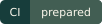</a>
  <a href="../LICENSE"></a>
  <a href="../pyproject.toml">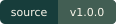</a>
  <a href="../pyproject.toml">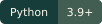</a>
  <a href="https://github.com/LucasXlab/skillvet">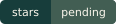</a>
</p>

在本地检查技能、hook 和 MCP 配置中的有限风险信号。查看发现对应的规则，以及扫描无法检查的部分。脚本只按文本读取，不会执行。

[English](../README.md) · [快速开始](#快速开始) · [检查第三方目录](#检查第三方目录) · [范围](#检查范围) · [MIT](../LICENSE)

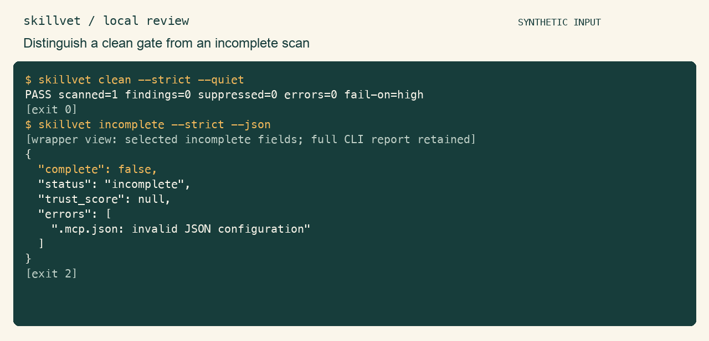

真实 CLI 使用合成样例。四处 JSON/SARIF 画面明确选择了报告字段；GIF 延长阅读停留。[原始 cast](../assets/demo.cast) · [完整 CLI 报告](../assets/reports/) · [录制文本](../assets/terminal.txt) · [复现方式](../assets/README.md)。演示是有限规则信号，不是安全结论。

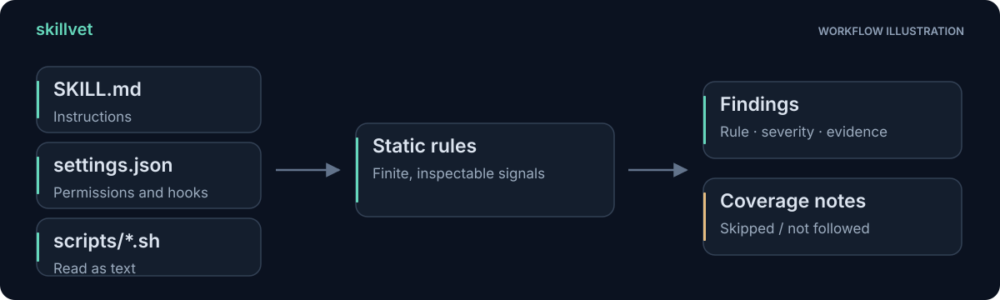

## 下载一个技能之后，先检查什么

指令文件只是包的一部分。hook 可能引用脚本，配置可能授予工具权限，目录还可能携带自己的抑制规则。skillvet 将支持的静态资产一起检查，输出发现和覆盖说明。

面对陌生输入，先用 `--strict`：忽略目标自身的 `.skillvetignore` 和行内抑制；调用者显式 `--ignore` 仍生效。无发现**不是安全结论**，动态行为与未知模式仍在模型之外。

| 审阅任务 | 手工起点 | skillvet 提供的支持 |
|---|---|---|
| 检查已知模式 | 搜索并阅读匹配文本 | 有限规则编号、严重度和来源位置 |
| 检查例外 | 阅读 ignore 文件和行内指令 | 明确的 skipped/suppressed 收据，以及 strict 模式对照 |
| 记录未检查输入 | 手工跟踪配置引用 | 支持范围内未跟随引用的说明，以及处理错误 |
| 接入本地审阅工具 | 手动整理发现 | 附处理状态的 JSON 和 SARIF |

这是工作流程对照，不是扫描精度比较。[规则注册表](../skillvet/rules.py)、[发现逻辑](../skillvet/discovery.py)和[报告模型](../skillvet/model.py)限定真实范围；目前没有真实 Skills 精确率/召回率或竞品优势结论。

## 快速开始

在源码目录，使用 macOS / Linux 与 Python 3.9+：

```sh
python3 -m venv .venv
.venv/bin/python -m pip install .
.venv/bin/skillvet examples/clean-skill --json
```

安装可能下载构建后端，扫描本身离线且无第三方运行依赖。此处安装当前源码，不声称已有注册表发行包。安全读取要求 POSIX 描述符相对文件访问，其他平台报扫描错误。

<details>
<summary>查看真实 CLI 输出节选</summary>

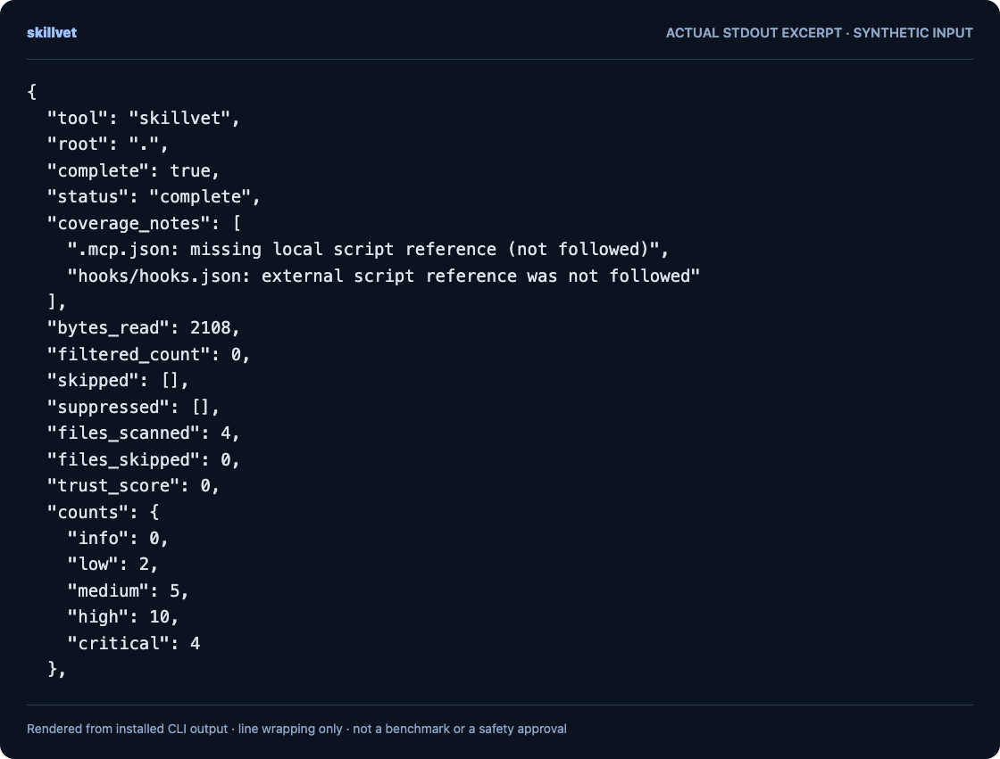

图像由真实 stdout 节选排版生成，不是虚构输出。JSON 节选可能不完整。[文本节选](../assets/readme-demo.txt) · [复现方式](../docs/readme-demo.md)。

</details>

## 检查第三方目录

```sh
.venv/bin/skillvet ./downloaded-skill --strict --json
.venv/bin/skillvet ./downloaded-skill --strict --sarif
.venv/bin/skillvet --list-rules
```

兼容模式会保留目标控制的例外，并在 `skipped` / `suppressed` 中记录；应检查这些收据，不能把没有显示发现当作覆盖完整。

### 审阅目标自己的例外

此合成目录跳过 `CLAUDE.md` 并抑制了两条发现。选字段 JSON 视图保留每项例外的来源和原因，此时分数为 null。

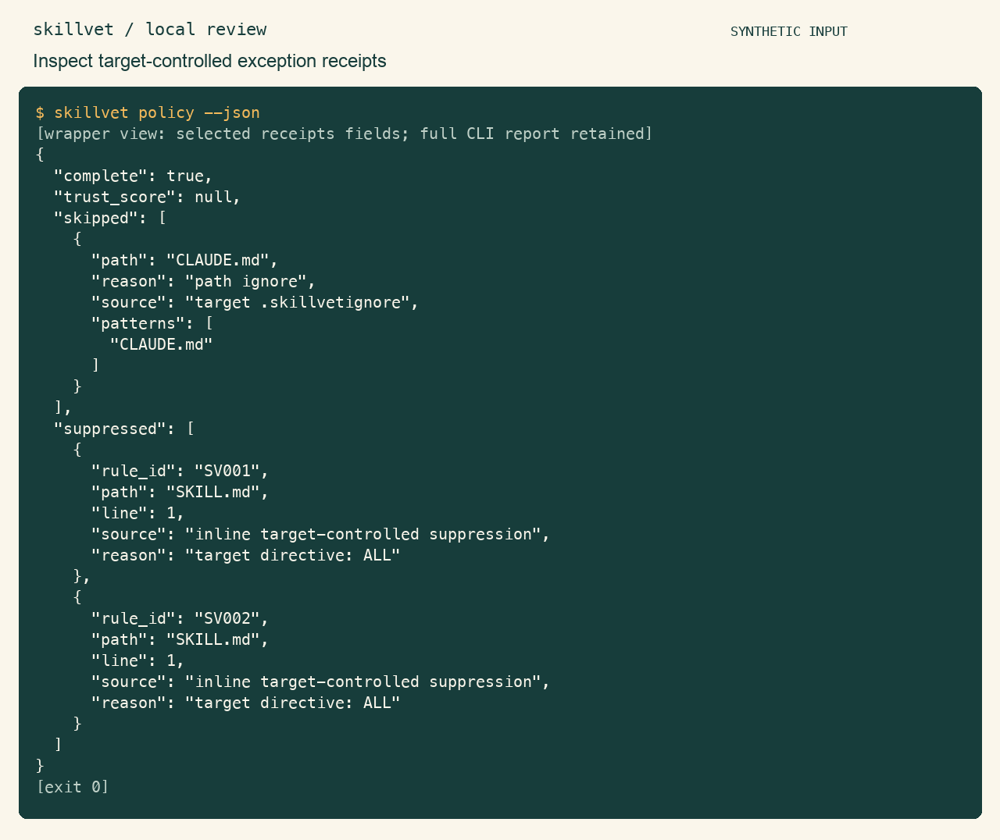

### 用 strict 模式再次检查

同一目录此时显示可识别的发现，并退出 1。调用者显式 ignore 仍然生效；strict 模式不证明覆盖完整。

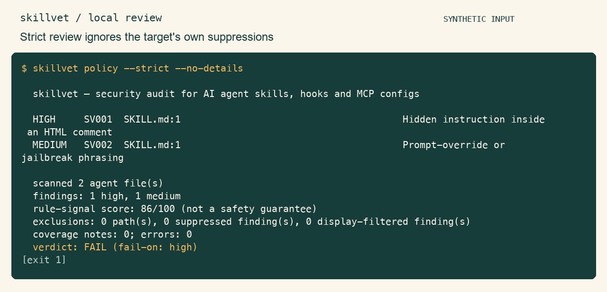

## 同时检查发现与覆盖

| 报告字段 | 需要追问 |
|---|---|
| 规则和严重度 | 哪个可检查模式触发了信号？ |
| `complete` / `errors` | 选中文件处理是否无错误地完成？ |
| `coverage_notes` | 哪些脚本引用无法静态跟随？ |
| `skipped` / `suppressed` | 哪些输入或发现被主动排除？ |

`complete: true` 不代表没有排除项或未跟随引用。旧 `trust_score` 是加权规则信号，不是安全概率；发生错误、排除、抑制或无资产时为 null。SARIF 保留规则严重度与不完整诊断，不捏造 CVSS 分数。`--min-severity` 只过滤显示，不能绕过退出门禁。

### 在 SARIF 中保留处理状态

下图选择了实际报告中的工具、执行、规则和位置字段。[完整 SARIF 报告](../assets/reports/sarif.sarif)保留未经筛选的输出；`executionSuccessful` 描述扫描处理是否完成，不是对输入的安全判定。

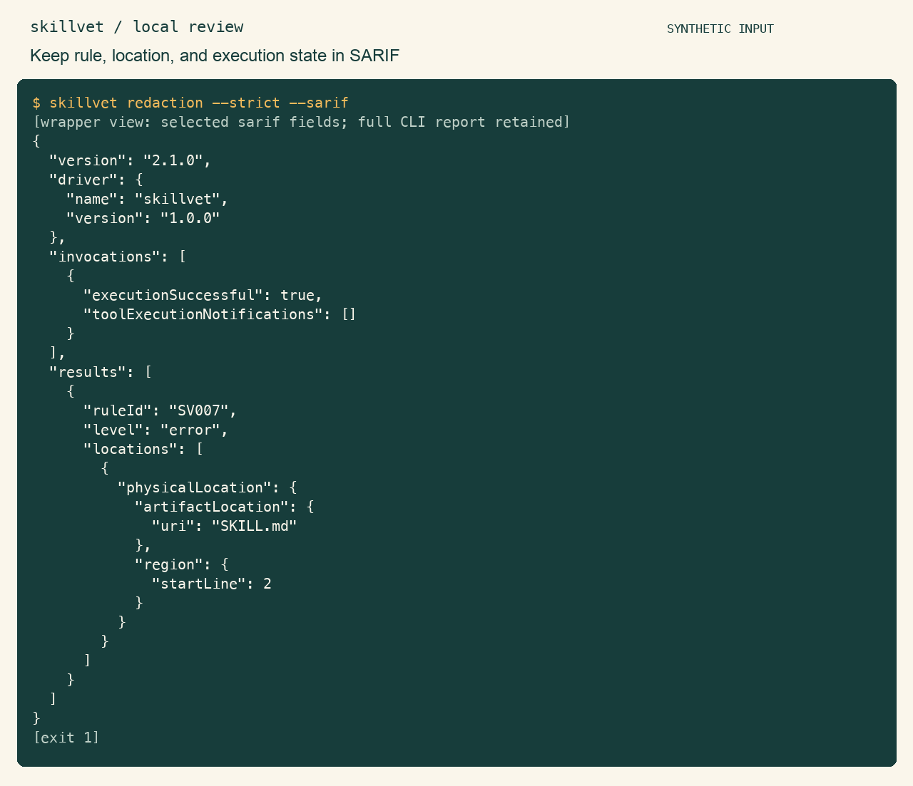

## 检查范围

- `SKILL.md`、`AGENTS.md`、`CLAUDE.md` 等已知指令文件。
- 已知 hook、MCP、plugin JSON 配置，包括嵌套 `.claude` 设置。
- 已识别 Agent 目录内脚本，以及配置命令中静态命名的脚本。相对引用先尝试项目根目录，再尝试配置目录；排除目标不会被读取。
- 精确的权限授予字段：`allowed-tools`、`allowed_tools`、`permissions.allow`、`permissions.tools`。deny 列表和描述不当作权限授予。

### 检查受支持的授权字段

frontmatter 只支持有限子集：顶层字符串、行内字符串列表、缩进字符串列表；双引号用 JSON 转义，单引号支持双写引号。锚点、别名、多行标量、嵌套映射、隐式数值 / 布尔 / null、重复字段与坏元数据均产生不完整扫描，不是通用 YAML 解析器。

此样例在受支持的 frontmatter 字段中授予 `Bash(*)` 与 `*`，产生 medium 发现；演示显式设置了 `--fail-on medium`。

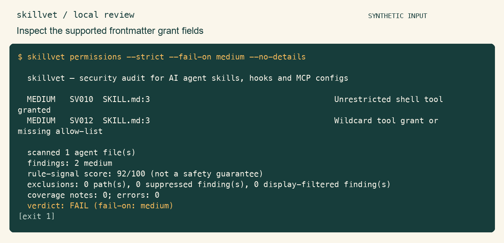

不展开动态 shell 表达式。外部、缺失或动态脚本引用记录在覆盖说明中；不递归解释脚本去推导任意后续执行。

## 边界与退出码

读取锚定根目录描述符，拒绝符号链接与特殊文件，并在读取前检查 ignore。根本身也不能是符号链接。默认每文件 1 MiB、总读取 16 MiB、选中文件 10,000、访问目录项 50,000；可用公开参数调整部分限额，超限标不完整。依赖、构建缓存和 `.git` 排除。变化中的目录不是快照。

| 退出码 | 含义 |
|---|---|
| `0` | 无扫描错误，且没有发现达到 `--fail-on`（默认 high） |
| `1` | 至少一个发现达到门槛 |
| `2` | 参数错误、选中文件读取 / 解析不完整或规则失败 |

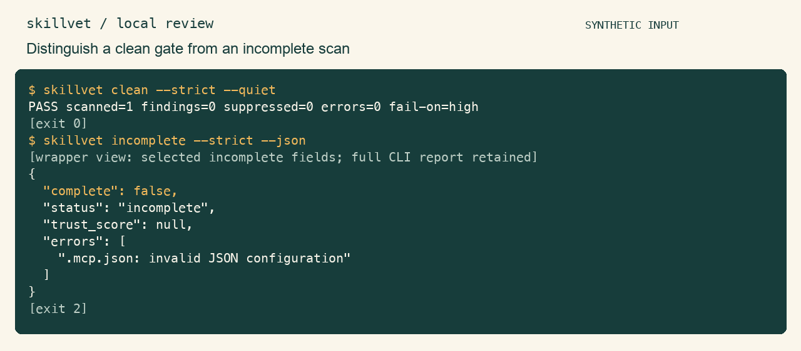

`--quiet` 只输出汇总行；`--no-details` 隐藏证据块。`NO_COLOR`、非 TTY、`--no-color` 禁用颜色。JSON 与 SARIF 互斥。

已知 token 模式与识别出的秘密值会在报告中掩盖；这仍是启发式，未识别的私人内容和文件名可能保留，分享前需复核。不会自动上传。

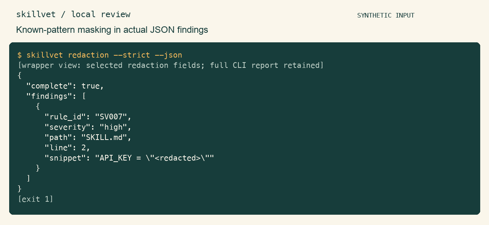

[完整 JSON 报告](../assets/reports/redaction.json)保留同样的遮挡证据。这只演示一个合成的已识别模式，不代表清除了所有秘密。

## 架构

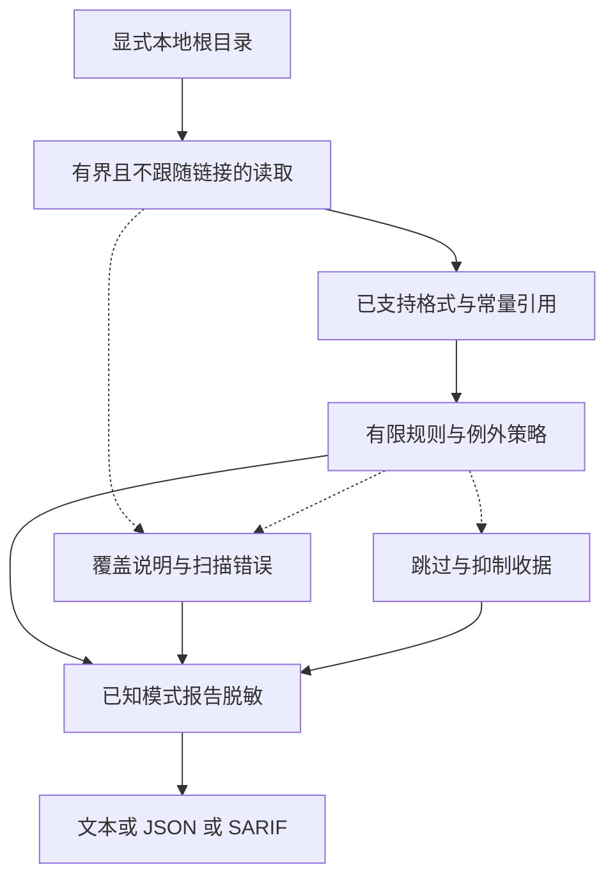

管线只读取静态文本和元数据，不运行被检查的指令或脚本。错误、排除项及未跟随引用与发现一起保留。

## 开发与贡献

```sh
make dev
make check
make demo
```

`make check` 运行 lint、格式、全包测试 / 至少 70% 语句覆盖和 wheel / source 构建。CI 配置不代表远端已执行。恶意示例是合成文本，禁止执行。

## 路线图

- [ ] 建立有版本的评测语料，包含经审阅误报和未检查样例。
- [ ] 通过明确、可审阅的元数据样例扩展格式支持。
- [ ] 改善跨次扫描的覆盖和例外收据比较。
- [ ] 在具备安全读取接口的平台上扩大实际验证。

## 参与贡献与安全

[参与贡献](../CONTRIBUTING.md) · [安全政策](../SECURITY.md)。使用合成样例，注明预期范围与退出码；可见输出变化时复现 [CLI 素材](../assets/README.md)。

## 许可证

[MIT](../LICENSE)，保留原版权声明。
